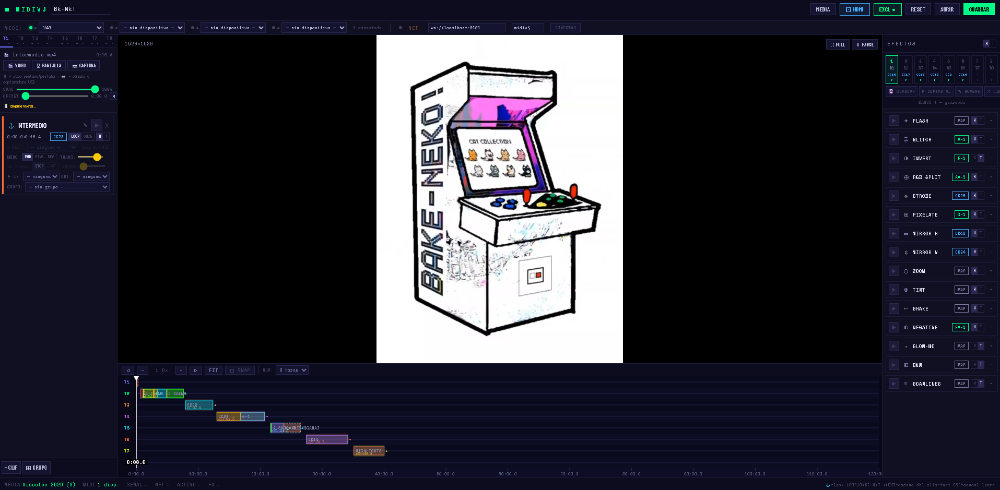
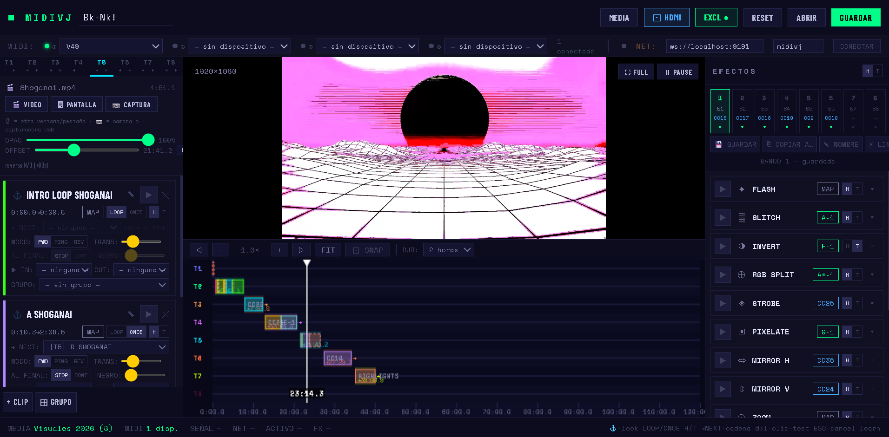

# MIDIVJ

Aplicación local de visuales en vivo controlada por MIDI. El runtime vive en `src/`, las sesiones `.vjp` en `Sessions/` y los medios locales en `videos/Visuales 2026/`.




## Instalar y actualizar

Necesitas [Node.js](https://nodejs.org) (versión LTS) y git. Clona el proyecto en tu carpeta de usuario (no en `Program Files`):

```bat
cd %USERPROFILE%
git clone https://github.com/Alfimero/MIDIVJ.git
```

Copia tus videos a `videos/Visuales 2026/`. Los videos, tus sesiones `.vjp` y `data/` quedan fuera de Git, así que las actualizaciones no los tocan. Para actualizar, cierra el relay y ejecuta:

```bat
cd %USERPROFILE%\MIDIVJ
git pull origin main
```

No hace falta nada más: al abrirse, los launchers comparan `node_modules` con `package-lock.json` e instalan solos lo que falte o haya cambiado. Si en ese momento no hay internet y sólo cambió una versión, avisan y arrancan con lo instalado.

## Ejecutar

En Windows, inicia `src/INICIAR_RELAY.bat`. En macOS, `src/INICIAR_RELAY.command` (doble clic). Los dos launchers usan la raíz real del proyecto, comprueban que Node.js esté instalado y mantienen al día las dependencias fijadas (`ws`, `selfsigned`). El relay **abre solo el navegador** con la aplicación, así que no hay que copiar ninguna dirección:

- Aplicación principal: `http://localhost:9191/`
- Emisor MIDI: `http://localhost:9191/sender`
- Control remoto (QR de conexión): `http://localhost:9191/control`
- Mando móvil: `http://localhost:9191/mando`
- Cámara móvil: `http://localhost:9191/camara` desde esta computadora; desde un teléfono necesita HTTPS — usa el QR de `/control` (ver más abajo)
- Salida a OBS: `http://localhost:9191/salida` (fuente de navegador; ver más abajo)

> **Macs viejos.** En un Mac anterior a macOS 11 (por ejemplo una MacBook Pro de 2012, que llega hasta Catalina 10.15) instala **Node 16**: [node-v16.20.2.pkg](https://nodejs.org/dist/v16.20.2/node-v16.20.2.pkg). Las versiones nuevas de Node se instalan sin avisar y al arrancar mueren con `dyld: Symbol not found`. El launcher `.command` detecta ese caso y lo dice.

Si el puerto 9191 está ocupado (por ejemplo, un relay que quedó abierto), el relay **prueba los siguientes** hasta el 9200 y anuncia el que eligió. La aplicación se conecta sola al relay que la sirvió, así que el cambio de puerto no rompe nada: no hace falta tocar el campo `NET`. Si la conexión se cae, la aplicación reintenta sola; **DESCONECTAR** la deja apagada a propósito.

También puedes ejecutar el relay manualmente desde la raíz:

```powershell
node .\src\midivj-relay.js
```

Acepta un puerto y `--sin-navegador` si prefieres abrir la página tú:

```powershell
node .\src\midivj-relay.js 9300 --sin-navegador
```

El botón **GUARDAR** envía la sesión al relay local. El servidor valida el nombre y crea un archivo nuevo dentro de `Sessions/`; nunca guarda sesiones en Descargas ni sobrescribe una existente. Los videos permanecen fuera de Git mediante `.gitignore`.

## Como usarlo

### MIDI

en la barra superior tienes la posibilidad de agregar hasta 4 controladores MIDI conectados a tu computadora, pero también tienes la posibilidad de recibir mediante Websocket MIDI desde otra computadora para mapear los tres elementos principales del programa mediante mensajes CC y Notas: CLIPS, EFECTOS y BANCOS.

### Videos

Para configurar tus visuales dirigete a la ventana lateral izquierda donde tendrás ocho Tracks de videos (T1...T8) donde podrás elegir la fuente de cada pista: 🎬 VIDEO (uno o varios archivos), 🖼 GALERÍA (una o varias imágenes), 🌐 NAVEGADOR (una URL), 🖥 PANTALLA, 📷 CAPTURA y 📱 CÁMARA. Una vez agregado Crea un CLIP en la parte inferior de la misma ventana y ahora podrás asignale un mensaje MIDI de CC o de Nota para disparar el CLIP.

Fuentes y **⚡ GENERAR CLIPS** (sección 🎞 MEDIOS del panel de pista):

- **🎬 VIDEO / 🖼 GALERÍA** aceptan varios archivos a la vez: todos entran a la lista de MEDIOS de la pista (videos e imágenes mezclados, en el orden que quieras) y el primero se carga en la pista si estaba vacía. Si la pista ya tiene un archivo, los nuevos sólo se agregan a la lista y aparece **⇄ USAR COMO FUENTE** para reemplazar el video actual (sin diálogos que congelen la salida en pleno show); cada entrada de MEDIOS tiene también su botón **⇄**. El botón **✕** junto al nombre de la fuente la quita de la pista (archivo o en vivo); los clips se conservan. GENERAR CLIPS crea un clip por cada medio, encadenados en orden (🔁 LOOP vuelve al primero al terminar); las imágenes duran lo que diga **SEG/IMG**. Es lo que antes hacía la PLAYLIST, ahora para cualquier formato.
- **🌐 NAVEGADOR**: pide una URL y la abre en una ventana aparte; después pulsa **📡 CAPTURAR** y elige esa ventana en el selector (el navegador no permite dibujar una página directamente en el canvas, así que se captura como PANTALLA). Son dos pasos porque abrir la ventana consume el gesto que la captura de pantalla exige.
- Con una fuente en vivo activa (NAVEGADOR, PANTALLA, CAPTURA o CÁMARA), GENERAR CLIPS crea un clip-interruptor (grupo FUENTE, modo toggle): mientras la pista tenga uno, la fuente sólo se ve cuando ese clip está activo, así se puede mostrar/ocultar por MIDI con transiciones de entrada y salida.
- Una fuente en vivo no tiene duración: en el timeline ocupa **todo el ancho** de su pista (bloque rayado, `● EN VIVO`; `○ OCULTA` mientras su interruptor la tiene apagada). Está en cualquier punto del cursor, encima o debajo de los videos de las otras pistas.

**Las pistas son capas** (T1 al fondo, T8 al frente): una cámara en T2 encima de un video en T1 deja que el video siga reproduciéndose debajo; con la opacidad de la de arriba al 50 % se ven las dos. **EXCL** (encabezado) decide qué apaga un clip al dispararse, y cada pista elige su modo en **🎞 AJUSTE Y TRANSICIÓN → EXCL**:

- **auto** (por defecto): un video reemplaza a otro video y una fuente en vivo a otra fuente en vivo (p. ej. cambiar entre dos cámaras con *disolver*), pero una cámara no detiene al video de fondo ni el video a la cámara.
- **capa (se superpone)**: la pista nunca apaga a las demás ni la apagan. Para dos videos a la vez, uno encima del otro. En el timeline la pista se marca `T2 ⧉`.
- **apaga todas las pistas**: como era EXCL antes, corta a cualquier pista.

**🧅 CAPAS por pista** (sección del panel de pista): una pista no se limita a una fuente. Además de su fuente principal (la capa **MEDIA**, con el motor de clips), puede apilar capas estáticas dibujadas de abajo hacia arriba:

- **🎨 COLOR**: pinta toda la salida con un tono homogéneo (selector de color). El botón `🎨 COLOR` de la fila de fuentes lo agrega como fondo, debajo de MEDIA. Sirve de base para videomapping: escálalo, gíralo o deforma sus esquinas con la caja interactiva igual que un video.
- **🖼 imagen**, **🎬 video en loop** (mudo, sin clips), **🖥 pantalla**, **📷 captura**, **🌐 navegador**: cada una con su propio ON/OFF, opacidad y orden (↑ al frente / ↓ al fondo). La cámara de teléfono 📱 sólo puede ser fuente principal.
- **TRANSFORM** actúa por defecto sobre **todas las capas de la pista a la vez** (`🔗 CAPAS` encendido): colocas el fondo de color donde quieres proyectar y el video, la imagen o la cámara caen en el mismo cuadrilátero. Apaga `🔗 CAPAS` si quieres transformar cada capa por separado (clic en el nombre de la capa para elegir cuál editan los sliders y la caja del canvas).
- GENERAR CLIPS crea además un clip-interruptor por capa (grupo CAPAS): dispararlo por MIDI prende/apaga la capa sin interrumpir el clip de video que esté sonando en la misma pista. Las capas, su orden y sus transforms se guardan en la sesión y en los bancos.

Cada pista tiene además, en ese mismo panel:

- **TRANSFORM DE PISTA**: posición, escala X/Y y rotación. El botón 🔗 vincula Escala X e Y para moverlas a la vez (también al arrastrar una esquina en el canvas).
- **CONFIG. DE CÁMARA** (con fuente CAPTURA): dispositivo, resolución/fps, **formato** (original, 16:9, 4:3, 1:1, 9:16 — el navegador recorta el centro) y los controles que exponga el driver de la cámara o capturadora (zoom, foco, exposición, ISO, balance de blancos, brillo, contraste, etc.). Lo que no aparece es porque el dispositivo no lo expone al navegador; la abertura nunca se expone. Con fuente 📱 CÁMARA la sección configura el teléfono (ver "Configurar la toma").
- **PROCESADOR DE VIDEO**: ganancia, brillo, contraste, gamma, balance de blancos, compensación de contraluz, matiz, saturación y nitidez, aplicados por software a cualquier fuente (archivo, pantalla, capturadora o cámara de teléfono). Se enciende solo al mover un slider; OFF lo deja en bypass.
- Doble clic sobre cualquier slider de parámetros (transform, efectos, cámara, procesador, opacidad) lo devuelve a su valor por defecto.

### CLIPS

Los CLIPS cuentan con las siguientes funciones que sirven para personalizar la ejecución de tus visuales:

- MAP: Mapeas el mensaje MIDI que quieres asignar para ejecutar el CLIP.
- LOOP: El CLIP Entrará en Loop, por lo que una vez finalice el CLIP regresa desde el inicio.
- ONCE: El CLIP Entrará en Once, por lo que una vez finalice el CLIP este termina, pero con la posibilidad de usar la función "NEXT".
- NEXT: Esta función permite que el CLIP se dirija a otro CLIP dentro o fuera del mismo TRACK, permitiendo brincar entre videos o CLIPS.
- MODOS: Dentro del LOOP sirven para que el video vaya hacia delante, de reversa o en ping/pong (todavía en pruebas)
- IN/OUT: Sirve para añadir a los CLIPS un Fade IN y/o Fade OUT.
- TRANS: Es para suavizar las transiciones entre CLIPS,
- GRUPOS: Permite agrupar CLIPS en grupos con la finalidad de tener una mejor organización, para esto tienes que crear los grupos que utilizarás y alojar los CLIPS en ese espacio. Ejemplo: Verso - 2 CLIPS | Coro - 3 CLIPS | Outro - 2 CLIPS

### TRACK VIEWER

Es la Ventana inferior central, tienes la posibilidad de observar todos tus tracks, desplazarte, zoom in/out y puedes observar el cursor que te indica la posición de todo el video.

- **Alto del panel**: por defecto se ajusta solo a las pistas que tienen contenido. Arrastra la manija del borde superior (la barrita del centro) para fijar un alto a mano; doble clic en la manija vuelve al alto automático.
- **Scroll vertical**: si las pistas no caben aparece una barra de desplazamiento; también Shift+rueda, o la rueda sobre los nombres T1…T8. El eje de tiempo queda siempre visible abajo.
- **Zoom vertical**: botones `↕−` / `↕+` o Alt+rueda (alto de cada fila). El zoom horizontal sigue en `−` / `+` o Ctrl+rueda.
- El alto del panel y el zoom vertical se recuerdan en ese navegador.
- **Mover un video en el timeline**: arrástralo directamente (su bloque o cualquiera de sus clips), sin Shift. Mientras lo arrastras, su inicio o su final se pega como un imán a los bordes de los videos de las otras pistas, al 0 y al cursor; mantén **Ctrl** para moverlo libre. Si llevas el puntero al borde derecho o izquierdo, el timeline se desplaza y se alarga solo: no hay límite. Un clic sin arrastrar sobre el bloque sigue moviendo el cursor (seek), y Alt+arrastrar un clip lo mueve dentro de su video, como antes.
- **⇥ SECUENCIA** (barra del timeline): pone los videos de las pistas uno detrás de otro, en el orden en que están, sin huecos ni solapes. **↶** deshace. Los videos de pistas distintas pueden coincidir en el tiempo (son capas); el imán y SECUENCIA sirven para alinearlos cuando quieres que vayan seguidos.
- Clic o arrastre sobre el eje de tiempo = mover el cursor (scrub).
- **OFFSET** (panel de pista): el mismo desplazamiento en números. Usa el slider o escribe el tiempo (`90`, `1:30` o `1:02:03`) y pulsa Enter. El timeline y la reproducción se alargan solos hasta el final del último video.

### BANCOS

Permiten guardar el estado de tu sesión para facilitar la reutilización de mensajes MIDI que planeas configurar, pudiendo de esta manera crear PRESETS por canciones tanto de CLIPS, como de EFECTOS o de los mismos BANCOS.

### EFECTOS

Son una lista variada de efectos de video de bajo consumo para modificar el resultado final de tus visuales.

## Control remoto: el celular como mando

Con el relay corriendo, hasta **cuatro teléfonos** pueden disparar tus visuales desde la misma red. El mando envía mensajes MIDI normales, así que **todo lo que puedas mapear con MIDI en MIDIVJ se puede poner en un botón del teléfono**, y el `MAP` de la aplicación aprende tocando un botón del celular igual que con un controlador físico.

### Conectar

1. Inicia `src/INICIAR_RELAY.bat` (o `src/INICIAR_RELAY.command` en macOS). Se abre la aplicación y **se conecta sola** al relay (sala `midivj`).
2. Pulsa **📡 RELAY** en el encabezado (entre `⊡ HDMI` y `EXCL`). Ese botón abre el panel de relay y mandos, y lleva el contador de teléfonos conectados: se pone verde cuando hay alguno.
3. En el panel, **📱 ABRIR QR DE MANDOS**. En el teléfono, escanea el QR del **Mando 1** (hay uno por dispositivo). Si la computadora tiene varias direcciones IP, elige arriba cuál usar.

### El panel de relay

Todo lo del relay se maneja desde ahí, sin buscar en la barra de estado:

- **Estado** — si hay relay, a qué dirección y sala; si no, que no lo hay.
- **1 · Iniciar el relay** — sólo aparece cuando falta. Trae la ruta del `.bat` y el comando, con botón para copiarlos, porque una página web no puede arrancar un proceso: el relay se inicia fuera del navegador. **🔍 BUSCAR RELAY** revisa los puertos 9191 a 9200 y se conecta al que encuentre (útil si el relay tomó otro puerto). Si abriste el HTML con doble clic, ofrece el enlace para abrir MIDIVJ desde el relay, que es como conviene usarlo.
- **2 · Conexión** — dirección y sala. Sólo hay que tocarlo para usar el relay de **otra** computadora.
- **3 · Teléfonos** — abre los QR y lista los mandos conectados.

Si al abrir MIDIVJ no hay relay, el panel **se abre solo** a los pocos segundos.

La página de control genera los QR **en local**, sin internet: sirve igual en una red sin salida a internet.

### Red creada por la computadora

Si no hay router, comparte la red desde Windows (Configuración → Red e Internet → Zona con cobertura inalámbrica móvil) o con `netsh wlan start hostednetwork` desde una consola de administrador. El adaptador virtual toma `192.168.137.1`: esa dirección aparece marcada como **hotspot** y encabeza la lista, porque es la que alcanzan los teléfonos unidos a esa red.

**La red se detecta sola**, en este orden: punto de acceso móvil encendido → `hostednetwork` iniciada → Wi-Fi a la que está conectada la computadora. De cada una se leen SSID y contraseña y se arma el QR para unirse con la cámara. Del punto de acceso móvil se leen aunque esté **apagado**: el QR queda listo y la página avisa que falta encenderlo. Sólo si Windows no reporta nada hay que escribir SSID y contraseña a mano en la página de control.

Todas esas consultas son de lectura (`netsh` y la API de Windows); el programa nunca enciende, apaga ni cambia una red por su cuenta.

Si el teléfono no abre la página (tiempo de espera agotado), revisa en este orden:

- **La dirección del QR.** Con una VPN instalada (Tailscale, WireGuard, etc.) la computadora tiene una dirección extra a la que el teléfono no llega. El relay pone esas direcciones al final, marcadas **VPN**, y la página de control elige la de la Wi-Fi; si la cambiaste a mano, vuelve a elegir la de tu Wi-Fi en el selector de arriba.
- **Cambiaste de red con el relay abierto.** El relay lo nota en unos segundos y renueva solo el certificado de la cámara para la IP nueva (no hace falta reiniciarlo); el teléfono vuelve a aceptar la advertencia una vez. La página de control se actualiza sola cada 15 s.
- **La misma red.** El teléfono tiene que estar en la misma Wi-Fi que esa dirección. Si el teléfono tiene una VPN activa, actívale el acceso a la red local o apágala.
- **El firewall.** La página de control muestra la regla exacta (`netsh advfirewall …`, puertos del mando y de la cámara, sólo perfil privado), y Windows debe marcar esa red como privada.

El relay es de red local; no lo expongas a internet.

### Mapear los botones con MAP

Cada botón del mando **nace con su propio mensaje MIDI libre** (nota 0, 1, 2… sin repetir y sin chocar con lo que ya usan tus clips, efectos y bancos). Por eso se mapea igual que un controlador físico:

1. En el mando, pulsa **🎯 MAPEAR**. En ese modo, tocar un botón sólo manda su mensaje: no salta de grupo ni se queda encendido, y cada botón muestra su número.
2. En MIDIVJ, pulsa **MAP** en el clip o el efecto (o **Asignar** en el banco). Aparece el aviso `● MIDI LEARN`.
3. Toca el botón en el teléfono. Queda mapeado; la pastilla del clip pasa a mostrar la nota.
4. Repite con los demás y sal de **🎯 MAPEAR**.

Funciona con todo lo que MIDIVJ ya sabe mapear: **clips**, **efectos** y **bancos**. Después, **✨ SUGERIR** en el inspector del botón le pone de etiqueta el nombre de lo que quedó mapeado.

MAP acepta las tres fuentes y las distingue en la pastilla:

| Fuente | Pastilla | Color |
| --- | --- | --- |
| Nota de un controlador | `C3`, `F#2`… | verde |
| CC de un controlador | `CC20` | azul |
| Botón de un mando | `M1·CORO` (mando y etiqueta del botón; si no tiene, su fila y columna) | amarillo |

El globo de ayuda de la pastilla siempre dice el mensaje real, así que puedes ver la nota exacta de un mapeo hecho desde el teléfono. La procedencia se guarda en la sesión `.vjp`.

Si prefieres el camino inverso —elegir el destino desde el teléfono— usa **DESTINO EN MIDIVJ** en el inspector: lista los clips, efectos y bancos con su mensaje y copia el que ya tengan asignado.

En el inspector, **🎲 LIBRE** toma un mensaje que no use ningún otro botón, y aparece un aviso en rojo si dos botones se pisan (MIDIVJ no distingue el canal: mismo tipo y número = mismo disparo).

### Personalizar los botones

En el mando, **✎ EDITAR** abre la barra de personalización:

- **Cuadrícula n×m** — filas y columnas, separación, radio, tamaño de texto y tema claro/oscuro.
- **Grupos** — cada pestaña es un grupo (por ejemplo `CLIPS`, `CORO`, `EFECTOS LENTOS`). Se crean, renombran y borran desde esa misma barra.
- **Botón** — al tocarlo en modo edición se abre su inspector: etiqueta, colores de fondo/texto/borde, forma (recto, redondeado, pastilla, círculo), brillo, tamaño en celdas (un botón puede ocupar varias), animación (pulso, latido, giro, parpadeo, onda) e **imagen o GIF** de fondo.
- **Texto sugerido** — el desplegable **DESTINO EN MIDIVJ** lista los clips, efectos y bancos de la sesión con su mensaje MIDI (`●` ya mapeado, `○` sin mapear): al elegir uno se rellena el mensaje y se propone su nombre como etiqueta. **✨ SUGERIR** hace lo mismo a partir del mensaje que ya tenga el botón.
- **Mensaje** — nota o CC, número, canal y modo: `Pulso` (on+off, ideal para lanzar clips), `Mantener` (mientras lo pisas, para efectos en HOLD) o `Alternar`. Normalmente no hay que tocarlo: el botón ya trae uno libre.

El layout es único y compartido: se edita desde cualquier dispositivo y el relay lo reparte al resto al instante. Se guarda en `data/mando-layout.json` (fuera de Git; cópialo si quieres respaldarlo).

### Submenús de efectos por clip

Un botón principal puede **alojar un grupo de efectos**: en su inspector, elige el grupo en *AL DISPARAR, ABRIR*. Al pulsarlo, el botón lanza su clip y ese teléfono salta al grupo de efectos.

El regreso al menú principal se elige en *VOLVER*:

- **al terminar el clip** — MIDIVJ avisa cuando el clip que lanzó ese botón deja de estar activo: al acabar un `ONCE`, al encadenar con `NEXT`, al detenerlo o al reemplazarlo por otro clip de la misma pista. Ojo: un clip en `LOOP` no termina solo, así que ahí conviene usar el retorno por tiempo o a mano.
- **a los N segundos** — temporizador.
- **sólo a mano** — con la barra `◀ VOLVER`, que siempre está visible dentro del submenú.

Cada dispositivo navega por su cuenta: el mando 1 puede estar en su submenú de efectos mientras el mando 2 sigue en la parrilla de clips.

## Control remoto: la cámara del teléfono

Un teléfono también puede ser una fuente de video más para una pista: `VIDEO`, `PANTALLA`, `CAPTURA` y ahora `📱 CÁMARA`. El video viaja **directo** entre el teléfono y la pestaña de MIDIVJ (WebRTC); el relay sólo negocia la conexión, igual que hace de mensajero para el mando, y nunca ve ni retransmite el video.

### Conectar

1. Con el relay corriendo, pulsa **📡 RELAY** en el encabezado y luego **📱 ABRIR QR DE CÁMARAS** (paso 4 del panel). Se abre la misma página `/control` que ya usa el mando, con una tarjeta y un QR por cada número de cámara (hasta 4).
2. En el teléfono, escanea el QR de una cámara libre. La página se conecta y queda **esperando**, sin encender la cámara todavía — no hay activación automática.
3. En una pista de MIDIVJ, pulsa **📱 CÁMARA**. Si hay un solo teléfono conectado y libre lo usa directo; si hay varios, pregunta cuál. El teléfono recién ahí pide permiso de cámara y empieza a transmitir.
4. Para soltarla, pulsa **✕** en la pista (o vuelve a pulsar **📱 CÁMARA**) — el teléfono apaga la cámara y vuelve a quedar disponible. También hay un botón **DETENER** en el propio teléfono.

### Configurar la toma

Desde la computadora (sección **⚙ CONFIG. DE CÁMARA · 📱** de la pista) o desde el propio teléfono (botón **⚙** en `/camara`), y se aplica en caliente sin cortar la transmisión:

- **Resolución**: 480p, 720p, 1080p o 4K (sólo lo que la cámara declara poder dar).
- **FPS**: 15, 24, 25, 30 o 60.
- **Formato**: *original* envía la toma tal cual (vertical u horizontal según cómo se sostenga el teléfono); 16:9, 9:16, 4:3, 3:4 y 1:1 recortan el centro **en el teléfono**, así lo que se ve allá es exactamente lo que llega (un teléfono en vertical puede mandar 16:9 y llenar la salida).
- **Calidad**: tope de Mbps del envío (auto, 2, 4, 8 o 15). Más Mbps = más nitidez, pero pide buena Wi-Fi.
- **Lente**: trasera o frontal.

El teléfono guarda su configuración y la muestra de los dos lados: la sección de la pista indica lo que el teléfono **envía** y lo que **llega** a MIDIVJ. WebRTC mantiene la resolución elegida y, si falta ancho de banda, baja los FPS. Si la sección se queda "esperando que el teléfono informe su configuración", recarga `/camara` en el teléfono y reinicia el relay (ambos tienen que estar actualizados).

### Notas

- **La primera vez, el teléfono muestra "conexión no privada".** `/camara` necesita HTTPS — es la única forma de que el navegador del teléfono dé acceso a la cámara en una IP de red, `getUserMedia` no funciona por HTTP salvo en `localhost`. El relay genera un certificado autofirmado en esta misma computadora (nada de internet ni de una CA real), así que el teléfono avisa que no reconoce el certificado: toca **Avanzado → continuar de todos modos**. Es esperado, una sola vez por teléfono (mientras la red no cambie), y no significa que algo esté mal.
- Sólo video, sin audio — igual que `PANTALLA` y `CAPTURA`.
- Cada cámara ocupa un slot propio (independiente de los slots del mando): un mismo teléfono puede abrir `/mando` y `/camara` a la vez si hace falta.
- Sin STUN ni TURN: la conexión sólo usa candidatos de la propia red local, consistente con que el resto del proyecto no depende de internet. Esto puede fallar en una red con "aislamiento de cliente" (poco común en routers domésticos o en el hotspot de esta misma PC, que es el escenario principal — ver `docs/decisions/ADR-004-camara-movil-por-webrtc.md`).
- Si el teléfono cierra la pestaña a media transmisión, el relay detecta la desconexión y avisa a MIDIVJ solo — no depende de que el teléfono alcance a despedirse.
- Si en la consola del relay aparece "Cámara de teléfono no disponible esta sesión", el HTTPS no pudo levantarse (raro); todo lo demás — video, pantalla, capturadora, mando — sigue funcionando igual.

## Salida a OBS: MIDIVJ como cámara virtual

Además de la ventana HDMI, el lienzo de salida se puede entregar a OBS (en esta misma PC o en otra de la red) como **Fuente de navegador**. El video viaja directo por WebRTC entre la pestaña de MIDIVJ y OBS; el relay sólo negocia la conexión y nunca lo retransmite. Con la fuente agregada, **Iniciar cámara virtual** de OBS expone la escena a Zoom/Meet/Discord como si fuera una webcam.

1. Pulsa **🎥 OBS** en el encabezado (o **📡 RELAY → 5 · SALIDA A OBS**) para ver la URL de `/salida`.
2. En OBS: **+ Fuente → Fuente de navegador**, pega la URL y pon ancho/alto iguales a la resolución de salida de MIDIVJ para que llene el cuadro sin recortar.
3. No hay botón de iniciar: en cuanto OBS abre la página, MIDIVJ empieza a transmitir. Hasta 4 fuentes simultáneas.

Notas: sólo video, sin audio (igual que HDMI/PANTALLA/CAPTURA/cámara). `/salida` va por HTTP normal — no necesita el certificado de `/camara` porque no pide permisos. Si recargas la fuente en OBS, se reconecta sola. Detalles en `docs/decisions/ADR-005-salida-a-obs-por-webrtc.md`.

## Audio: mover visuales con sonido

El botón **🔊 AUDIO** abre el primer módulo desacoplado de MIDIVJ (`src/modules/audio/`). Analiza una entrada de audio (interfaz, micrófono, loopback) dentro de un `AudioWorklet` y convierte lo que oye en dos cosas:

- **Valores continuos** (RMS, pico, envolvente, bandas low/mid/high) → cualquier parámetro registrado: opacidad de cada pista, intensidad de FLASH, escala de ZOOM, los siete de TRANSFORM, etc.
- **Eventos** (`gate.open`, `gate.close`, `peak.detected`, silencio) → disparar un clip, un banco o un efecto.

Analizar **no** es escuchar: el monitor arranca en 0 y el sonido de la sala sigue yendo por la consola. Las entradas se abren sin cancelación de eco, supresión de ruido ni AGC. En Windows la captura es WASAPI compartido (ASIO y modo exclusivo no existen desde un navegador). La configuración se guarda en la sesión `.vjp`; al reabrirla las entradas quedan **pendiente** hasta pulsar RECONECTAR, porque el navegador exige un gesto.

Si el módulo no carga (por ejemplo al abrir el HTML como `file://`), el botón se esconde y MIDIVJ funciona igual que antes. Guía completa en `docs/audio-module.md`; fases futuras en `docs/audio-module-roadmap.md`; decisión en `docs/decisions/ADR-006-modulo-de-audio.md`.

## Hacia dónde va el código

`docs/architecture/auditoria-modular-y-lite.md` mide el estado de la modularización y `docs/decisions/ADR-007-extraccion-del-nucleo-y-perfil-lite.md` fija el plan: extraer el núcleo de `Midivj ZYX.html` por pasos sin reescribirlo, para poder trabajar cada módulo por separado y derivar una versión LITE para iOS/Android como recorte de módulos.

## Graphify

Graphify 0.9.16 se usa como índice técnico local. Como la lógica principal está embebida en HTML y el modo `--code-only` no analiza HTML como código, el flujo genera copias JavaScript en `graphify-src/` (más una copia de `src/modules/`) antes de construir el grafo.

```powershell
powershell -ExecutionPolicy Bypass -File .\scripts\Update-Graphify.ps1 -CodeOnly
```

Consulta `PROJECT.md`, `AGENTS.md` y `docs/operations/graphify.md`. No publiques `graphify-out/`; sus relaciones inferidas no son hechos confirmados.
